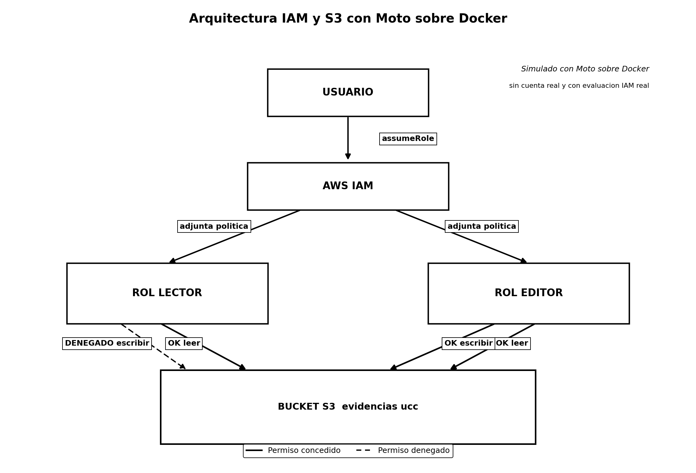

# IAM + S3 + STS en AWS simulado con Moto y Docker

Caso práctico de **gestión de identidades y permisos** ejecutado **sin cuenta real de AWS**: un bucket S3 privado, dos roles IAM con políticas distintas, credenciales temporales vía `sts:AssumeRole` y evidencia real de un `AccessDenied`.

El proveedor es [Moto](https://github.com/getmoto/moto) corriendo en Docker, en `http://localhost:4566` (cuenta `000000000000`, región `us-east-1`). Todas las credenciales son ficticias.

**Estado verificado:** 13/13 comprobaciones correctas y 16/16 llamadas HTTP correctas.



---

## 1. Qué se demuestra

- Bucket S3 privado **`evidencias-ucc`**.
- **`RolLector`**: puede listar y leer objetos, **no puede escribir**.
- **`RolEditor`**: puede listar, leer **y escribir** objetos.
- `sts:AssumeRole` entrega credenciales temporales a cada rol.
- El Lector recibe un **`AccessDenied` real** al intentar subir `prueba_lector.txt`, mientras que el Editor sí sube `evidencia_subida.txt`.

La denegación no es simulada por el script: Moto evalúa la política IAM adjunta al rol asumido en cada llamada.

---

## 2. Requisitos

- Docker con `docker compose` (Docker Desktop funciona bien).
- Python 3.10 o superior.
- PowerShell (Windows) o `pwsh` (Linux/macOS).
- Sin cuenta de AWS, sin token de pago y sin credenciales reales.

Instala la única dependencia local:

```powershell
python -m pip install -r requirements.txt
```

> `awscli` se invoca como `python -m awscli`, así que no hace falta tener `aws.exe` en el `PATH`. `botocore` llega como dependencia y se usa para firmar las peticiones HTTP con SigV4.

---

## 3. Ejecución completa (un solo comando)

```powershell
powershell -ExecutionPolicy Bypass -File .\scripts\todo.ps1
```

Ese script hace, en orden:

1. `scripts/iniciar.ps1` → construye/levanta Moto y espera al puerto 4566.
2. `scripts/ejecutar.ps1` → resetea Moto, crea usuario admin, bucket, roles, políticas, asume los roles y guarda las evidencias en `evidencias/`.
3. `scripts/generar_http.py` → genera `pruebas.http` y `pruebas_httpie.json` con las credenciales vigentes y verifica las 16 llamadas.

También puedes ejecutar los pasos por separado:

```powershell
powershell -ExecutionPolicy Bypass -File .\scripts\iniciar.ps1
powershell -ExecutionPolicy Bypass -File .\scripts\ejecutar.ps1
python scripts\generar_http.py

.\scripts\detener.ps1     # solo detiene el contenedor
.\scripts\limpiar.ps1     # baja el contenedor y borra .tmp (conserva evidencias/)
```

Cada ejecución de `ejecutar.ps1` parte de un estado limpio usando `/moto-api/reset` y `/moto-api/reset-auth`, por lo que el resultado es repetible. Después de ejecutarlo de nuevo, vuelve a correr `generar_http.py`: las credenciales cambian y las firmas anteriormente generadas dejan de ser válidas.

---

## 4. Arquitectura

```text
AWS CLI (python -m awscli)  /  HTTPie  /  REST Client
         |  endpoint http://localhost:4566
         v
Contenedor Docker: aws-moto-final-cloud  (moto_server, puerto 4566)
         |
         +-- IAM: usuario admin + política AdminTodo
         |       +-- rol RolLector  -> política SoloLectura
         |       +-- rol RolEditor  -> política LecturaEscritura
         +-- STS: AssumeRole -> credenciales temporales por sesión
         +-- S3 : bucket evidencias-ucc
                 +-- archivo_lectura.txt        (subido por admin)
                 +-- evidencia_subida.txt       (subido por RolEditor)
                 x-- prueba_lector.txt          (RECHAZADO al RolLector)
```

### Políticas IAM

| Archivo | Contenido | Se aplica a |
|---|---|---|
| `iam/trust.json` | Permite `sts:AssumeRole` (Principal `AWS: "*"`) | Ambos roles |
| `iam/politica_lectura.json` | `s3:GetObject`, `s3:ListBucket` sobre `evidencias-ucc` | `RolLector` |
| `iam/politica_editor.json` | Lo anterior + `s3:PutObject` | `RolEditor` |
| `iam/politica_admin.json` | `Action: "*", Resource: "*"` | usuario `admin` del arranque |

### Arranque con autorización activada

Moto empieza con `INITIAL_NO_AUTH_ACTION_COUNT=3` (en `docker-compose.yml`). Las tres primeras llamadas crean:

1. el usuario `admin`;
2. su access key;
3. su política `AdminTodo`.

A partir de la cuarta llamada, **toda** petición se autoriza contra las políticas existentes.

---

## 5. Estructura del proyecto

| Ruta | Descripción |
|---|---|
| `Dockerfile`, `docker-compose.yml` | Imagen Moto 5.2.5, puerto 4566 y bootstrap IAM. |
| `.dockerignore`, `.gitignore` | Evitan enviar/subir el documento base, `.tmp` y artefactos locales. |
| `requirements.txt` | AWS CLI v1 (y `botocore` como dependencia). |
| `.aws/config`, `.aws/credentials` | Perfil `moto`: endpoint local y credenciales **ficticias** `test`/`test`. |
| `iam/*.json` | Confianza y políticas IAM. |
| `scripts/todo.ps1` | Ejecuta todo en un solo paso. |
| `scripts/iniciar.ps1` | Levanta Docker y espera al puerto. |
| `scripts/ejecutar.ps1` | Caso práctico completo y evidencias. |
| `scripts/generar_http.py` | Genera y verifica las pruebas HTTP. |
| `scripts/detener.ps1`, `scripts/limpiar.ps1` | Detener / eliminar el entorno. |
| `pruebas_httpie.json` | Export para importar en HTTPie Desktop/Web. |
| `pruebas.http` | Llamadas para REST Client / JetBrains HTTP Client. |
| `evidencias/` | 17 archivos A–D y resumen de verificación. |
| `archivo_lectura.txt`, `prueba_lector.txt`, `evidencia_subida.txt` | Archivos usados por las pruebas. |
| `.tmp/` | Credenciales temporales generadas en cada ejecución (ignorado por Git). |

---

## 6. Evidencias

| Paso | Acción | Archivo |
|---|---|---|
| Inicio | Identidad del perfil | `evidencias/00_get_caller_identity.txt` |
| Bucket | Crear bucket, subir archivo inicial y listar | `01_crear_bucket.txt`, `02_subir_archivo_inicial.txt`, `03_listado_inicial.txt` |
| Roles | Crear `RolLector` y `RolEditor` con sus políticas | `04`–`10_*.txt` |
| Evidencia A | El Lector asumido lista y lee | `11_evidencia_A_lector_lee.txt` |
| Evidencia B | El Lector asumido intenta escribir → `AccessDenied` | `12_evidencia_B_lector_no_escribe.txt` |
| Evidencia C | El Editor asumido lee y escribe | `13_evidencia_C_editor_lee.txt`, `14_evidencia_C_editor_escribe.txt` |
| Evidencia D | Estado final del bucket | `15_evidencia_D_estado_final.txt` |
| Resumen | 13 comprobaciones | `00_resumen_verificacion.txt` |

Cada archivo incluye el comando, la fecha y la salida real. Las evidencias A–C incluyen además la identidad devuelta por `sts get-caller-identity`.

La prueba decisiva:

```text
An error occurred (AccessDenied) when calling the PutObject operation: Access Denied
--- Identidad AWS usada (STS) ---
"Arn": "arn:aws:sts::000000000000:assumed-role/RolLector/SesionLector"
```

---

## 7. Pruebas HTTP (`pruebas_httpie.json` y `pruebas.http`)

Moto valida criptográficamente la firma AWS SigV4: no basta con pegar una URL. Las peticiones llevan `Authorization`, `X-Amz-Date` y, para los roles asumidos, `X-Amz-Security-Token`.

`scripts/generar_http.py` firma 16 peticiones con una fecha fija (`20260101T000000Z`) y genera:

- **`pruebas_httpie.json`** — export oficial de HTTPie Desktop/Web (esquema `httpie/schema` v1.0.0).
- **`pruebas.http`** — para VS Code REST Client / JetBrains HTTP Client.

### HTTPie Desktop / Web

1. Abre **Import** (menú `+`).
2. Elige **HTTPie Desktop** y selecciona `pruebas_httpie.json` (o pega el JSON en la pestaña **Text**).
3. Se importa la colección **"Casos de uso (16 llamadas)"**. Ejecuta los requests en orden.

### REST Client

Abre `pruebas.http` y pulsa *Send Request* en cada bloque `###`, en orden.

### Casos incluidos

| Bloque | Petición | Esperado |
|---|---|---|
| 1–2 | `GET /moto-api`, `GET /moto-api/data.json` | `200` |
| 3–6 | Admin: identidad, roles y políticas | `200` |
| 7–9 | Lector asumido: identidad, listar y leer | `200` |
| **10** | Lector asumido: `PUT prueba_http_lector.txt` | **`403 AccessDenied`** |
| 11–12 | Editor asumido: identidad y listado | `200` |
| **13** | Editor asumido: `PUT evidencia_http_editor.txt` | `200` |
| 14–16 | Admin: comprobar, borrar y ver estado final | `200`, `204`, `200` |

No edites cabeceras, cuerpos ni parámetros: cualquier cambio invalida la firma. Los bloques 14–16 limpian el objeto temporal, así que el bucket queda con `archivo_lectura.txt` y `evidencia_subida.txt`.

Resultado real de la verificación: **16/16 llamadas correctas**, con un único `403 AccessDenied` (el esperado).

---

## 8. Notas

- **Sin AWS real.** No se usó ninguna cuenta de AWS; nada sale del contenedor. Las credenciales de `.aws/credentials` son `test`/`test`.
- **Estado en memoria.** Al ejecutar `limpiar.ps1` o recrear el contenedor, bucket y roles desaparecen; vuelven con `scripts/todo.ps1`.
- **Mensaje de error.** Moto devuelve `AccessDenied` con el texto genérico `Access Denied`. La denegación es real y la identidad asumida se muestra por separado en la evidencia B.
- **`file://` en Windows.** La propuesta original usaba `--policy-document file://iam/trust.json`; con AWS CLI v1 en Windows esa ruta no se resuelve, así que el script lee el JSON y lo pasa como cadena (equivalente funcional).
- **Visor web.** Está en `http://localhost:4566/moto-api`. La raíz `/` devuelve `500` porque un navegador no envía la firma AWS; no indica que el emulador esté caído.
- **Grabación de video.** Queda fuera de este repositorio; aquí están la infraestructura, los comandos y las evidencias necesarias.
